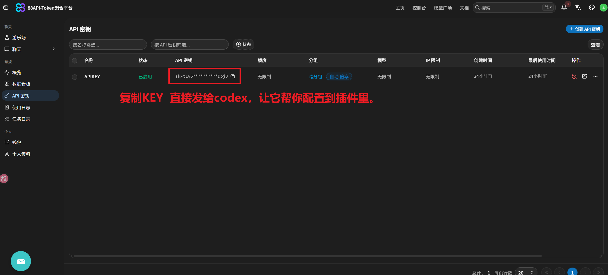

# 88API-Image-Gen

**一个插件，调用 [88API](https://88api.ai/) 的全部生图模型。** 在 Claude Code、Codex、ZCode 等 Agent 客户端里直接用中文说「画一张……」「把这张图改成……」，插件会选对模型、走对接口、把图存到本地。

- **模型全覆盖**：GPT Image、Gemini（Nano Banana）、Grok Imagine、Seedream、Midjourney，共 17 个模型
- **文生图、改图、多参考图**：本地图片或公网图片链接都能当参考图
- **1K / 2K / 4K、比例、质量档位、透明背景**：一个参数，插件换算成各模型自己的写法
- **上新模型不用等插件升级**：模型能力来自 88API 文档站，插件每天自动更新
- **付费安全**：参数不对在付费前就拦下；已受理的请求绝不自动重发；中断后可以免费查清有没有出图

支持 **Claude Code、Codex、ZCode、DeepSeek Harness、Trae**，以及 Cursor、Cline、Windsurf、Gemini CLI 等能读 `SKILL.md` 技能、能运行本机 Node.js 18+ 的客户端。

> 原 **88API-Nano-Banana** 插件已停止更新，Gemini 生图并入本插件；装好本插件后 Nano 的 Key 会自动迁移。DeepSeek Harness 原生插件 **dsh-plugin-88api-image** 也已停止更新，装过的请先在插件设置里卸载，再安装本插件。

> 🎬 **想做视频？** 试试姊妹插件 [88API-Video-Studio](https://github.com/blackdm666/88API-Video-Studio)：一句话出短片或 TVC 广告片，还能反推参考视频的提示词。和本插件共用同一个 88API Key，见下方[视频生成插件](#视频生成插件88api-video-studio)。

## 快速开始

**1. 安装插件**

| 客户端 | 安装方式 |
| --- | --- |
| Claude Code | 在对话里输入 `/plugin marketplace add blackdm666/88API-image-gen`，再输入 `/plugin install 88api-image-gen@88api-plugins` |
| Codex | 终端运行 `codex plugin marketplace add blackdm666/88API-image-gen`，然后在插件列表里安装 **88API-Image-Gen** |
| ZCode | **设置 → Plugins → Create → Add marketplace**，填入 `blackdm666/88API-image-gen`，然后安装 **88api-image-gen** |
| DeepSeek Harness | 打开「添加插件」，填入 `github:blackdm666/88API-image-gen`，点「安装」，然后新开对话 |
| Trae | 终端运行 `npx skills add blackdm666/88API-image-gen -g -a trae -y`（装到 `~/.trae/skills/`），然后新开对话 |
| 其它客户端 | 把 [`plugins/88api-image-gen/skills/88api-image-gen/`](plugins/88api-image-gen/skills/88api-image-gen/) 整个文件夹复制到客户端的技能目录（见下方） |

<details>
<summary>其它客户端的技能目录</summary>

| 客户端 | 用户级技能目录 |
| --- | --- |
| DeepSeek Harness（不用插件时） | `~/.dsh/skills/` 或 `~/.agents/skills/` |
| Trae（不用命令时） | `~/.trae/skills/`（Windows 为 `%USERPROFILE%\.trae\skills\`）；只给一个项目用时放项目里的 `.trae/skills/` |
| Cursor、Gemini CLI 等认公共目录的客户端 | `~/.agents/skills/` |
| Cline | `~/.cline/skills/` |
| ZCode（不用插件时） | `~/.zcode/skills/` |

复制后保持文件夹名为 `88api-image-gen`，新开对话让客户端重新加载技能。DeepSeek Harness 两种方式选一种即可；两种都装了时，用插件装的那份。

</details>

**2. 准备一个 88API Key**

登录 [88api.ai](https://88api.ai/)，在「API 密钥」页面创建一个 Key，分组选 `auto`。一个 Key 就够，并发由 88API 自动分配。




**3. 直接说需求**

新开对话，描述你想要的图。第一次使用时 Agent 会发现还没配置 Key，并主动向你要；把 Key 发给它，它会自动保存、脱敏验证，然后继续你的任务，不需要你运行任何命令。

```text
画一张 16:9 的雨夜城市海报，霓虹灯倒映在积水里。
用 Nano Banana Pro 把这张截图里的文字改成英文，排版不变。
用 az-gpt-image-2 做一张透明背景的熊猫贴纸。
用我发的人物图和产品图，生成一张 4K 的产品展示图。
用 Grok 把这张照片改成水彩画风格。
用 Midjourney 出 4 张赛博朋克概念图。
```

Codex 里在输入框输入 `@` 选择 **88API-Image-Gen** 再描述；Claude Code、ZCode 直接描述即可。

## 选哪个模型

没指定时用默认的 `gpt-image-2`。点名模型或系列（如「用 Nano Banana」「用 Grok」）就用对应模型，只影响这一次。

| 系列 | 模型 | 适合 | 分辨率 | 计费 |
| --- | --- | --- | --- | --- |
| GPT Image | `gpt-image-2`（默认）、`gpt-image-2.5-flare`、`gpt-image-2.5-sunburst` | 通用出图和改图，精确像素尺寸 | 1K / 2K / 4K | 按张 |
| GPT Image 原生参数 | `az-gpt-image-2`、`az-gpt-image-2.5-flare`、`az-gpt-image-2.5-sunburst` | 透明背景、指定输出格式、更高质量档位、单次多张 | 1K / 2K / 4K | 按 token |
| Gemini（Nano Banana） | `gemini-3.1-flash-image`、`gemini-nano-banana-2.1`、`gemini-3-pro-image` | 文字渲染、人物一致性、按参考图精修 | 1K / 2K / 4K | 按次 |
| Grok Imagine | `grok-imagine-image`、`grok-imagine-image-quality`、`grok-imagine-image-2.0`、`grok-imagine-edit` | 出图快、比例多（15 种） | 1K / 2K | 按张 |
| Seedream | `doubao-seedream-5-0-pro` | 商业视觉、海报，支持最多 14 张公网参考图 | 1K / 2K | 按张 |
| Midjourney | `midjourney-v8.2`、`midjourney-v8.2-fast`、`midjourney-v8.2-turbo` | 艺术创作、概念设计，一次出 4 张 | — | 按次 |

具体价格以 [88API 模型广场](https://88api.ai/pricing) 为准。你的 Key 能用哪些模型，可以让 Agent 运行 `--list-models` 查看（免费），结果里 `available: true` 的就是当前分组可用的模型。

## 参数速查

一般不需要记这些，直接用自然语言说就行，Agent 会换成参数。每个模型支持哪些取值，以插件读取的模型清单为准；不支持时会在付费前报错，并列出可用的取值。

| 参数 | 说明 |
| --- | --- |
| `--aspect 16:9` | 画面比例。GPT Image、Gemini 各 10 种，Grok 15 种（含 `auto`），Seedream 不指定比例 |
| `--resolution 1K\|2K\|4K` | 分辨率档位，不传时默认 1K。同一档位不同模型像素不同，例如 1K 16:9 在 GPT Image、Grok 上是 1280×720，在 Gemini 上是 1376×768 |
| `--quality` | 质量档位，例如 `low\|medium\|high`；`az-gpt-image-2.5-*` 另有 `xhigh\|max`，`grok-imagine-image-2.0` 是 `low\|medium\|auto` |
| `--background transparent` | 透明背景，仅 `az-gpt-image-*`，需配合 `--output-format png` 或 `webp` |
| `--image <路径或链接>` | 参考图，可以重复多次；上限因模型而异，例如 `gpt-image-2` 4 张、Grok 3 张、`gemini-nano-banana-2.1` 6 张 |
| `--output-dir <目录>` | 保存位置，默认 `~/Pictures/88api-image-gen`；在只能写工作目录的沙箱客户端里自动改存到工作目录下的 `88api-images` |
| `--dry-run` | 只打印将要发出的请求，不花钱 |

<details>
<summary>GPT Image 像素对照（所有 GPT Image 模型相同）</summary>

| 比例 | 1K | 2K | 4K |
| --- | ---: | ---: | ---: |
| 1:1 | 1024×1024 | 2048×2048 | 2880×2880 |
| 3:2 | 1536×1024 | 2400×1600 | 3504×2336 |
| 2:3 | 1024×1536 | 1600×2400 | 2336×3504 |
| 4:3 | 1152×864 | 2048×1536 | 3264×2448 |
| 3:4 | 864×1152 | 1536×2048 | 2448×3264 |
| 16:9 | 1280×720 | 2560×1440 | 3840×2160 |
| 9:16 | 720×1280 | 1440×2560 | 2160×3840 |
| 21:9 | 1344×576 | 3024×1296 | 3840×1648 |
| 2:1 | 1408×704 | 2880×1440 | 3840×1920 |
| 1:2 | 704×1408 | 1440×2880 | 1920×3840 |

其它模型的像素见 88API 文档站各模型页面，或让 Agent 用 `--dry-run` 查看。

</details>

## 费用与安全

- **付费前校验**：比例、分辨率、质量、背景、参考图张数不符合模型能力时，直接报错，不发请求、不花钱。
- **绝不自动重发**：请求一旦可能已被 88API 受理，插件就不会自动重试、换模型或换接口，避免重复扣费。你明确说「重试」时，Agent 才会再提交一次。
- **免费查清状态**：每次付费运行都会留提交记录。客户端中断了、不确定有没有出图时，运行 `--job-status` 就能看到每个请求是已保存、未发出、被拒绝，还是状态未知（可能已扣费）。
- **结果下载失败可免费重下**：图已生成但下载失败时，插件会先免费重试，并保存结果链接，之后可以用 `--retry-download` 再下一次。
- **Key 只存在本机**：保存在 `~/.88api/image-gen.json`，本机所有客户端共用，Agent 只显示脱敏后的 Key。不想把 Key 发进对话，也可以设置环境变量 `API88_KEY`。只在信任的对话里提供 Key，不要贴到 Issue、公开聊天或截图里。
- **模型清单只能指向 88API**：清单来自 `https://88api.ai/helper/image-models.json`，只允许 88api.ai 上固定的接口路径；格式不对或被篡改时，插件改用本机缓存或内置快照。

## 长任务与中断

一张图通常十几秒到一分钟，高质量、4K 或 Gemini Pro 可能要几分钟，最长等 10 分钟。有些客户端会更早结束命令，例如 Claude Code 默认 2 分钟超时，所以技能会让 Agent 把付费命令放到后台运行。

命令被中断时，请求可能已经被受理并扣费。不要直接重发，先让 Agent 运行 `--job-status` 查一下。

<details>
<summary>Codex Auto 模式提示外网审批 429</summary>

Codex 的 Auto 模式会在插件访问网络前先做外网执行审批。如果报错里出现「外部网络执行授权」「沙箱网络权限」「审批服务」，或审批服务返回的 `429 Too Many Requests`，那是 Codex 审批层的限流，不是 88API、Key 或模型的问题。被拦下的任务没有发到 88API，不会扣费。

想避免反复审批：

1. Windows 按 `Ctrl+,` 打开 Codex 设置。
2. 进入 **General（通用）→ Permissions（权限）**，启用 **Full access（完全访问）**。
3. 回到任务，在输入框下方的权限菜单里选择 **Full access（完全访问）**。
4. 把剩下的图片合成一条批量命令重新提交。

Full access 会取消当前任务的本地沙箱和审批限制，请自行决定是否开启；插件不会自动改你的权限设置。选项灰掉时可能是组织策略限制，这时继续用一条批量命令，只审批一次即可。

</details>

## 常见问题

- **技能没生效 / Codex 的 `@` 菜单里没有插件**：更新或重新安装插件，然后新开对话 / 新建任务。
- **怎么确认装的是哪个版本**：让 Agent 运行 `--version`，或 `--get-config`，看「插件版本」一项。
- **点名的模型用不了**：说明你的 Key 所在分组不提供这个模型。请求照样会发出，88API 会提示哪些分组可以用，这类拒绝不扣费。
- **改图后画面被裁成了方形**：v3.0.3 起，不指定比例时会跟随第一张参考图的比例；想要别的比例就直接说「改成 16:9」。
- **在 DeepSeek Harness 等沙箱客户端里提示目录不可写**：v3.0.3 起会自动把图和提交记录存到当前工作目录下（`88api-images`、`.88api-image-gen-jobs`），并打印实际位置。
- **88API 新上了模型，插件不认识**：插件每天自动更新一次模型清单，也可以让 Agent 运行 `--refresh-models` 立即更新。
- **`request was not sent`**：连不上 88API，请求没发出、没扣费，插件会自动重试。
- **`stage: read-result`**：图已生成并扣费，只是读取结果时连接断了。
- **`stage: download`**：图已生成并扣费，下载失败了。报错里有一个 `.pending-download.json` 文件，用 `--retry-download <这个文件>` 可以免费再下载一次，链接大约 1 小时后失效。
- **出现 `[NO-AUTO-RETRY]` 或请求超时**：之前的请求可能已经扣费，插件不会自己重发。你明确说「重试」后，Agent 会再提交一次。
- **从旧版升级**：旧配置自动迁移。`gpt-image-2-4k` 已下线，会自动换成 `gpt-image-2` + 4K；旧的 `--quality 2K/4K` 按分辨率处理。

<details>
<summary>命令行用法（高级）</summary>

技能脚本位于 `plugins/88api-image-gen/skills/88api-image-gen/scripts/generate.mjs`，需要 Node.js 18+。

```powershell
node generate.mjs --set-key "<YOUR_88API_KEY>"
node generate.mjs --get-config
node generate.mjs --list-models
node generate.mjs --self-test
node generate.mjs --model gemini-3-pro-image --prompt "一只坐在窗边的橘猫" --aspect 3:4 --resolution 2K --dry-run
node generate.mjs --edit --model grok-imagine-image --image cat.png --prompt "改成水彩画风格"
node generate.mjs --job-status
```

完整参数见 `node generate.mjs --help`。

</details>

## 升级

- **Claude Code**：终端运行 `claude plugin marketplace update 88api-plugins` 和 `claude plugin update 88api-image-gen@88api-plugins`（也可以在对话里输入 `/plugin` 打开插件管理更新），然后新开对话。
- **Codex**：`codex plugin marketplace upgrade 88api-plugins`，然后新建任务。
- **ZCode**：在插件设置里更新 **88api-image-gen**。
- **DeepSeek Harness**：暂不支持插件自动更新。在插件设置里卸载 **88API-Image-Gen**，再按安装步骤重新添加；重新添加后完全退出并重新打开 DSH（托盘里的也要退出），然后新开对话。
- **Trae**：终端运行 `npx skills update -g -y`；手动复制安装的，用新版技能文件夹覆盖旧的。然后新开对话。
- **其它客户端**：用新版技能文件夹覆盖旧的。

## 视频生成插件：88API-Video-Studio

[88API-Video-Studio](https://github.com/blackdm666/88API-Video-Studio) 是 88API 的视频生成插件，和本插件搭配使用：先用本插件做关键帧、人物或产品图，再交给它生成视频。

| 用法 | 你说 | 它做 |
| --- | --- | --- |
| 想法 → 成片 | 「做一条 10 秒竖屏运动鞋广告。」 | 列出 88API 当前的视频模型和实时价格，你选定模型后生成短片或 TVC，超长时自动拆段再拼接 |
| 视频 → 反推 | 「反推这个视频的提示词。」 | 抽帧逐帧分析运镜、动作、文字和声音，给出可以直接生成的提示词 |
| 视频 → 复刻工程包 | 「把这个参考片做成可复刻工程包，我要换成自己的产品。」 | 在反推基础上整理素材清单和分段提示词，补齐素材即可一键生成 |

- **安装**：目前是 Codex 插件，终端运行 `codex plugin marketplace add blackdm666/88API-Video-Studio`，然后在插件列表里安装。
- **凭据**：会复用本插件已保存的 88API Key；查询余额和价格另需一个 88API 个人访问令牌，首次使用时 Agent 会引导配置。
- **需要**：Node.js 18+；反推和拼接需要 ffmpeg。
- 付费提交前会先估算金额并等你确认；专注单条短片与 TVC，不做多集短剧。

## 项目信息

- 版本：`3.1.2`
- GitHub：[blackdm666/88API-image-gen](https://github.com/blackdm666/88API-image-gen)
- 插件名：`88api-image-gen@88api-plugins`（Claude Code、Codex、ZCode 相同）；DeepSeek Harness 插件包名 `88api-image-gen`
- 开发说明：[docs/项目说明.md](docs/项目说明.md)
- 更新说明：[v3.1.2](docs/更新说明-v3.1.2.md)；[v3.1.1](docs/更新说明-v3.1.1.md)；[v3.1.0](docs/更新说明-v3.1.0.md)；[v3.0.4](docs/更新说明-v3.0.4.md)；[v3.0.3](docs/更新说明-v3.0.3.md)；[v3.0.2](docs/更新说明-v3.0.2.md)；[v3.0.1](docs/更新说明-v3.0.1.md)；[v3.0.0](docs/更新说明-v3.0.0.md)；[v2.3.0](docs/更新说明-v2.3.0.md)；[v2.2.0](docs/更新说明-v2.2.0.md)；[v2.1.0](docs/更新说明-v2.1.0.md)；[v2.0.0 破坏性变更](docs/更新说明-v2.0.0.md)
